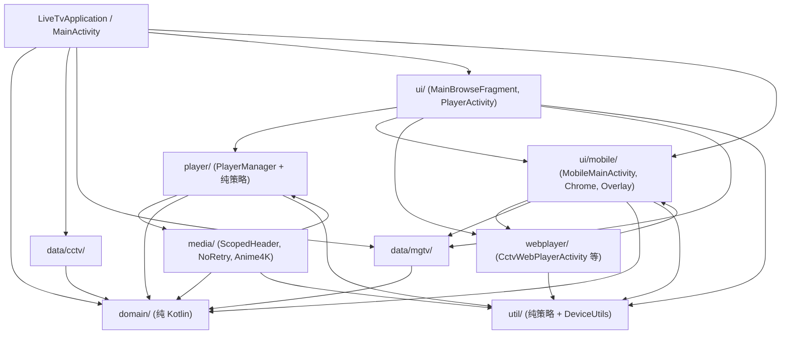
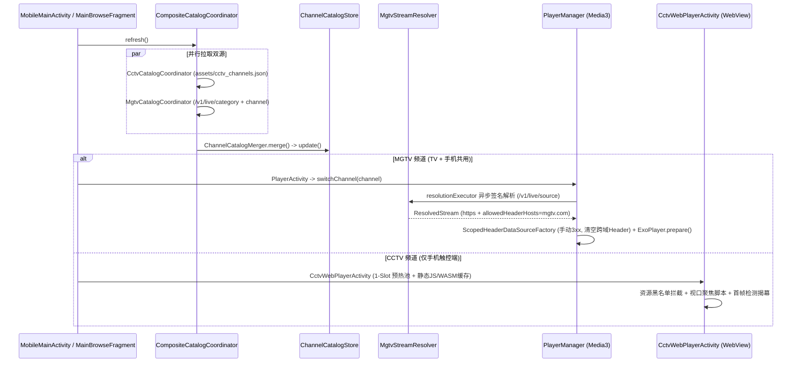

# LiveTV 架构剖析与目标架构设计（ARCHITECTURE_REVIEW）

> 关联主索引与源码证据：[PROJECT_AUDIT.md](PROJECT_AUDIT.md)

---

## 1. 当前真实包依赖与调用链

### 1.1 包依赖方向图（真实现状）

> **关键发现**：
> - `domain/`、`data/*/`、`player/`（策略部分）、`media/`、`util/` 之间分层干净，无反向或循环依赖。
> - **唯一结构性反向耦合（`AUD-13`）**：TV 端 `MainBrowseFragment` / `ChannelCardPresenter` 与双端共用 `PlayerActivity` 直接导入了 `ui/mobile/` 下的 `MobileChannelList` 与 `MobileUiPreferences`。

### 1.2 双源目录加载与播放链路

---

## 2. 架构合理性评估

### 2.1 整体定性：**整体架构克制且合理，核心分层经受住了多阶段演进**
- **单 `app` 模块 + `LiveTvApplication` 手动装配**：在当前 1.5 万行代码、2 个主要业务域（CCTV + MGTV）的规模下，不引入 Hilt/Dagger 与多模块拆分的决策完全正确，构建速度与心智负担控制得很好。
- **纯 Kotlin 策略抽离**：`player/` 策略层（受 `PlayerLayerPurityTest` 守护）、`domain/`、`util/` 的纯函数化让 440 个 JVM 单元测试能脱离模拟器秒级运行。

### 2.2 明确评估：**CCTV 与 MGTV 不应强行抽象统一播放控制接口**
- **现状**：UI 外框（`MobilePlayerChromeController` 通过 `PlayerChromeCapabilities.MGTV / CCTV` 差异化槽位、`MobilePlayerLoadingOverlay`、`MobilePlayerTransitionHelper`）已经实现高比例复用。
- **判断**：底层引擎（Media3 `ExoPlayer` vs `WebView` + JS 轮询 + 预热池 + `onRenderProcessGone`）能力集高度异构。若强行抽出一套 `PlaybackEngine` 接口，只会制造大量空实现（`setVideoEnhanceMode` / `getVideoInfoSnapshot` 对 WebView 无意义；`toggleWebControls` / `warmSlot` 对 ExoPlayer 无意义），属于典型的**过度抽象**。当前在 `MobileMainActivity.openChannel` 与抽屉切换处做轻量路由是最优解。

---

## 3. 最小侵入式目标架构（不拆模块、不引重型框架）

1. **修复 P0 运行时与资源缺陷**：
   - 修复 `CctvWebPlayerActivity.onCreate()` 双重创建 `WebView`（`AUD-01`）。
   - 为 `PlayerManager` 增加 `release()` 并在 `PlayerActivity.onDestroy()` 关闭 `resolutionExecutor`（`AUD-02`）。
   - 统一 `MgtvStreamResolver` 与 `PlayerManager` 的 `Clock` 注入基准为 `MonotonicClock`（`AUD-03`）。
2. **局部解耦共享纯逻辑与降低切台串行阻塞（`AUD-06`, `AUD-13`, `AUD-14`）**：
   - 将 `MobileChannelList` 中被 TV 端复用的纯展示辅助函数（`prependFavoritesCategory`、`sanitizeSubtitle`、`extractChannelBadge`、`categoryAccentIndex`）以及 `MobileUiPreferences` 上移到 `domain/` / `util/`（或 `data/prefs/`），消除 TV → `ui/mobile/` 反向依赖。
   - 将 `CctvWebGestureController` 与 `PlayerTouchGestureMath` 的亮度/音量计算收口到 `util/PlayerTouchGestureMath.kt`。
   - 切台时并行触发网络解析/WebView 准备与 `PixelCopy` 截帧，避免串行等待 1 Vsync + 截图耗时。

---

## 4. 明确“不动清单”（设计合理、严禁无意义重构）

| 模块 / 类 | 原因 |
|---|---|
| `domain/` 全包（`ChannelCatalogStore`、`CompositeCatalogCoordinator`、`StreamRefreshCoordinator`、`HeaderHostPolicy`、`SessionGenerationGate`） | 纯 Kotlin 零耦合，并发代次门控与分槽合并逻辑严密，单测覆盖充分 |
| `data/cctv/` & `data/mgtv/`（除 `AUD-03` 时钟传参外） | 接口边界清晰，签名/选源/Fail-Closed 逻辑经过实测与单测验证 |
| `player/` 纯策略层（`PlaybackReducer`、`RetryPolicy`、`ChannelNavigator`、`PlaybackErrorMapper`） | 受 `PlayerLayerPurityTest` 强制守护，状态机单测完备 |
| `media/ScopedHeaderDataSourceFactory` & `NoRetryOnClientErrorPolicy` | 手动跟随 3xx 并剥离非白名单请求头、401/403/429 快速失败设计精准 |
| `ui/mobile/MobilePlayerChromeController` & `MobilePlayerLoadingOverlay` | Cutout Inset 隔离、`fadeOutToGone()` 防隐形拦截、`CompositeTouchDelegate` 48dp 热区均已到位 |
| `webplayer/CctvWebWarmup`、`CctvWebStaticResourceCache`、`CctvWebSwitchGeneration` | 轻量、fail-open、具备内存修剪响应与防旧回调覆盖保护 |
