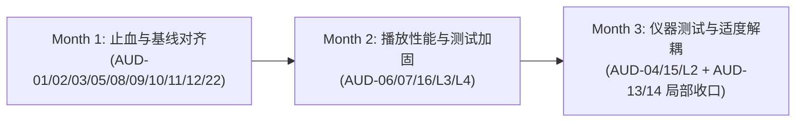

# LiveTV 下一阶段技术路线图（ROADMAP_PROPOSAL，3 个月）

> 关联审计报告：[PROJECT_AUDIT.md](PROJECT_AUDIT.md) · [TECH_DEBT.md](TECH_DEBT.md) · [TEST_GAP.md](TEST_GAP.md)
> 遵循原则：不拆多模块、不引入 DI/重型第三方框架、不通过删功能简化架构。

---

## 阶段总览与依赖顺序

---

## Month 1：止血修复与文档基线对齐（第 1–4 周）

**目标**：消除冷启动冗余开销、生命周期/线程泄漏、时钟错位与双端状态不同步，恢复文档与代码 100% 一致。

| 序号 | 任务项 | 对应编号 | 7 项评估结论摘要（详情见 `TECH_DEBT.md`） | 预估工时 |
|---|---|---|---|---:|
| 1.1 | 修复 CCTV 冷启动双倍创建/销毁 WebView | `AUD-01` | 1) `onCreate`+`beginWebViewLoad` 重建两次；2) 拖慢冷切 TTFF；3) `CctvWebPlayerActivity.kt:293-324,959-980`；4) 显著降低冷启动首帧耗时；5) 0.5 人日；6) 核对首次脚本注入；7) **是** | 0.5d |
| 1.2 | 修复 `PlayerManager.resolutionExecutor` 线程泄漏 | `AUD-02` | 1) 从未 `shutdown`；2) 销毁播放页泄漏线程；3) `PlayerManager.kt:128-131,257-271`；4) 消除线程泄漏；5) 0.5 人日；6) 仅在 `onDestroy` 调用 `release()`；7) **是** | 0.5d |
| 1.3 | 统一 `MonotonicClock` 时钟基准 | `AUD-03` | 1) `nanoTime` vs `currentTimeMillis`；2) TTL 比较恒失效；3) `MgtvStreamResolver.kt:46` vs `PlayerManager.kt:57`；4) 恢复准确过期刷新；5) 0.2 人日；6) 几乎无风险；7) **是** | 0.2d |
| 1.4 | 修复播放状态/并发边界细节（`STATE_ENDED`、`removeCallbacks`、`scheduleReload`、`lastNpuk`） | `AUD-09`~`AUD-12` | 1–3) 见 `TECH_DEBT.md` 表；4) 消除直播断流黑屏、槽位过期丢失与并发隐患；5) 1.3 人日；6) 局部小改易回滚；7) **是** | 1.3d |
| 1.5 | TV 首页 `MainBrowseFragment` 增加 `onResume()` 收藏同步 | `AUD-08` | 1) 仅 `onCreate` 读收藏；2) 返回首页收藏不更新；3) `MainBrowseFragment.kt:53-80`；4) 双端体验一致；5) 0.5 人日；6) 对比 `favoriteIds` 差异避免焦点闪烁；7) **是** | 0.5d |
| 1.6 | 校准 `AGENTS.md`、`docs/*.md` 与 CI SDK 冗余 | `AUD-05`、`AUD-22` | 1–3) 见 `PROJECT_AUDIT.md` §4；4) 消除协作与 Agent 误导；5) 1.2 人日；6) 纯文档/CI 清理零业务风险；7) **是** | 1.2d |

**Month 1 验收标准**：
- `./gradlew lintDebug testDebugUnitTest assembleDebug assembleRelease --offline --console=plain --no-daemon` 全绿。
- 真机实测 CCTV 冷启动仅初始化 1 个 `WebView`（可通过日志验证）；TV 端播放页收藏返回即更新；`AGENTS.md` 与 `docs/` 全部描述与源码一致。

---

## Month 2：TTFF / 超分性能优化与 L1/L3/L4 质量防线（第 5–8 周）

**目标**：降低 MGTV/CCTV 切台首帧延迟、减少超分帧开销，并补齐网络策略测试与 Release CI 防线。

| 序号 | 任务项 | 对应编号 | 7 项评估结论摘要 | 预估工时 |
|---|---|---|---|---:|
| 2.1 | 切台 `PixelCopy` 与网络解析/WebView 加载并行化 | `AUD-06` | 1) 当前串行等待 `PixelCopy`；2) 白耗 1 Vsync+截图时间；3) `PlayerActivity.kt:872-881`、`CctvWebPlayerActivity.kt:988-1016`；4) 缩短切台 TTFF；5) 1 人日；6) 需保证截帧先于新表面覆盖；7) **是** | 1.0d |
| 2.2 | `Anime4kCnnGlEffect` 预缓存 Uniform Location | `AUD-07` | 1) 每帧 17–18 pass 查 `glGetUniformLocation`；2) CPU/GC 开销大；3) `Anime4kCnnGlEffect.kt:160-165,194-223`；4) 降低超分帧耗时；5) 0.5 人日；6) 真机双档位回归；7) **是** | 0.5d |
| 2.3 | 补齐 L1 HTTP / `ScopedHeaderDataSourceFactory` / `NoRetryOnClientErrorPolicy` 单测 | `AUD-16` | 详见 [TEST_GAP.md §3 方案 A](TEST_GAP.md#3-l1l4-分层测试落地方案含-7-项评估) | 1.0d |
| 2.4 | 落地 L3 真机 ADB 自动化回归脚本 + L4 CI `assembleRelease` 门禁 | `AUD-04` | 详见 [TEST_GAP.md §3 方案 C / D](TEST_GAP.md#3-l1l4-分层测试落地方案含-7-项评估) | 2.0d |

**Month 2 验收标准**：
- L1 单测覆盖 302 跨协议脱敏、401/403/429/5xx 与读超时边界；PR CI 强制校验 `assembleRelease`。
- PKG110 真机自动化脚本一键完成 MGTV/CCTV 播放、超分双档位切换与 0 崩溃检查。

---

## Month 3：L2 仪器测试兜底与轻量结构整理（第 9–12 周）

**目标**：建立关键 `androidTest` 回归防线，并按需做低风险局部结构清理（严格控制范围，不做大拆）。

| 序号 | 任务项 | 对应编号 | 7 项评估结论摘要 | 预估工时 |
|---|---|---|---|---:|
| 3.1 | 引入轻量 `androidTest`（D-Pad 拦截 + Activity 生命周期 + WebView `onRenderProcessGone`） | `AUD-15` | 详见 [TEST_GAP.md §3 方案 B](TEST_GAP.md#3-l1l4-分层测试落地方案含-7-项评估) | 2.5d |
| 3.2 | 收口双端手势数学 & 上移 TV 复用的共享辅助类（仅限确实复用的类） | `AUD-13`、`AUD-14` | 1) TV 与 `PlayerActivity` 导入 `ui/mobile/`；手势数学微弱分叉；2) 包耦合与微小重复；3) `CctvWebGestureController.kt:158-201`、`MainBrowseFragment.kt:30-31`；4) 消除反向依赖；5) 1.5 人日；6) 纯包移动与单函数收口，易回滚；7) **是**（轻量整理，不拆大 Activity） | 1.5d |

**Month 3 验收标准**：
- `connectedAndroidTest`（或 CI 模拟器）稳定跑通 D-Pad 切台、错误重试与 WebView 渲染进程崩溃恢复用例。
- `ui/mobile/` 不再被 TV 首页反向导入。

---

## 明确暂缓 / 不纳入 3 个月路线图的功能与重构

1. **CCTV 与 MGTV 引擎层强行统一接口**：能力差异过大，保持 UI 外框共享 + 引擎分治。
2. **EPG 节目单全链路研发（`AUD-17`）**：缺少稳定公开数据源，投入产出比低。
3. **TV 端搜索 / 首页继续观看卡片（`AUD-18`）**：TV 端当前有效频道基数小，遥控器直选即可满足。
4. **`CctvWebPlayerActivity` / `PlayerActivity` 大规模拆分重构（`AUD-14`）**：仅收口重复工具函数，不建议为了追求文件行数拆出大量碎片类。
5. **超分关闭恢复硬件 `SurfaceView api=3`（`AUD-20`）**：Media3 运行时切换 Effects 限制，重建播放器代价过高。

---

## 风险与缓冲

- **外部平台接口/页面改版风险（高）**：MGTV 签名/CDN 策略与央视网 DOM 结构随时可能变化，需依赖 Month 2 建立的 L3 真机脚本快速探测。
- **时间缓冲**：每月按约 4–5 人日核心研发量规划，预留充分的真机回归与线上问题响应缓冲。
